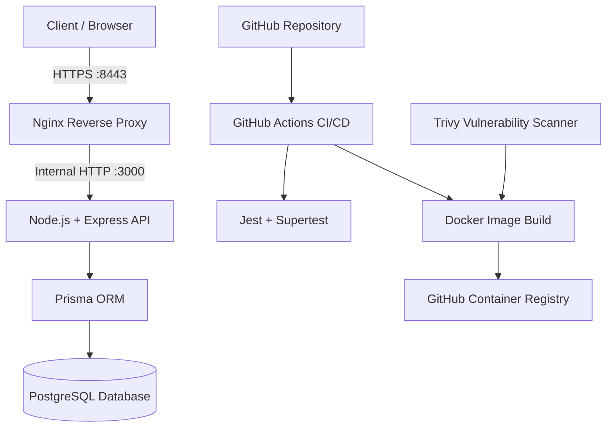

# Cinema Ticketing Platform – Architecture

## System Architecture

## Component Responsibilities

| Component | Responsibility |
|---|---|
| Client | Sends API requests |
| Nginx | HTTPS termination and reverse proxy |
| Node.js / Express | Handles application logic and REST APIs |
| Prisma | Database access and ORM |
| PostgreSQL | Stores shows, seats and reservations |
| GitHub Actions | Automates tests and Docker image publishing |
| GHCR | Stores versioned container images |
| Trivy | Scans container images for vulnerabilities |
| Jest / Supertest | Executes automated API and concurrency tests |

## Reservation Workflow

1. Customer requests available shows.
2. Customer retrieves the seat map.
3. Customer requests a temporary seat hold.
4. API checks seat availability and prevents duplicate active reservations.
5. Customer confirms or cancels the reservation.
6. Database updates the reservation status and seat availability.